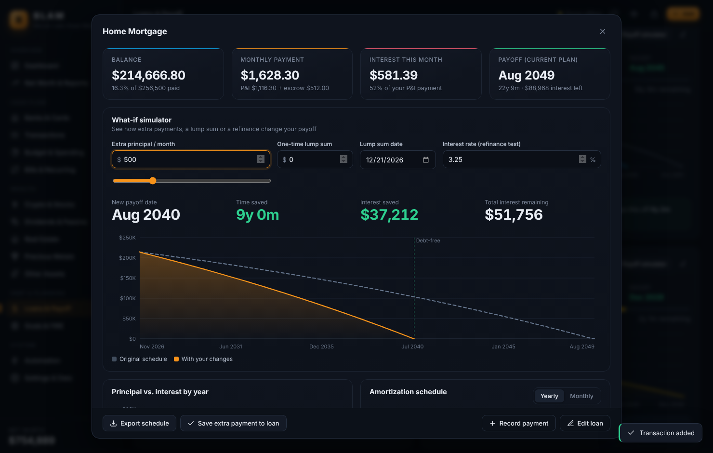

<p align="center"></p>

<h1 align="center">BLAM — Bitcoin Labz Asset Manager</h1>

<p align="center"><b>A private, local-first desktop command center for your entire financial life.</b><br>
Crypto · Stocks · ETFs · Dividends · Real Estate · Rentals · Mortgages · Metals · Passive Income · Budgets · Every Bank & Card</p>

<p align="center"></p>

---

## Why BLAM

Most finance apps want your bank password and live in someone else's cloud. BLAM runs **entirely on your computer**. No account, no subscription, no telemetry. The only network calls are anonymous price lookups for your tickers.

## Features

| Area | What you get |
|---|---|
| **Dashboard** | Net worth with daily history, asset allocation, today's market move, passive income, cash flow, savings rate, upcoming bills, top holdings, debt payoff progress |
| **Crypto & Stocks** | Live prices (CoinGecko for 10,000+ coins, Yahoo Finance for stocks/ETFs/funds), 24h change, cost basis, gain/loss, weight, yield, buy/sell trades with realized gain (average-cost), coin search |
| **Dividends & Passive** | One-click dividend sync (payout history + trailing yield), dividend calendar with 12-month forward projection, yield on cost, passive assets (vending, notes, royalties, staking, businesses…) |
| **Real Estate** | Equity, LTV, NOI, cap rate, cash-on-cash, DSCR, GRM, 1% rule, 10-year equity projection, multi-unit tenants & lease expiration alerts |
| **Loans & Payoff** | Full amortization schedules, payoff date charts, extra-payment & lump-sum **what-if simulator**, refinance test, interest saved, CSV export, **avalanche vs. snowball** planner across every loan and credit card |
| **Banks & Cards** | Checking, savings, HYSA, CDs, credit cards, 401(k)/IRA, HSA, exchanges. Credit utilization, interest cost, APY earnings, reconcile balances |
| **Transactions** | Fast ledger, search & filters, bulk re-categorize, **free bank-file import**: OFX / QFX / QBO (your bank's "Download for Quicken/QuickBooks") with exact duplicate detection and balance matching, or CSV from any bank with column mapping, plus smart auto-categorization |
| **Budget & Spending** | Monthly budgets by category, auto-budget from your 3-month average, spending pace vs. budget, 12-month trend by group |
| **Bills & Recurring** | Paychecks, bills, subscriptions, transfers and **self-amortizing loan payments** that auto-post on schedule |
| **Precious Metals** | Gold, silver, platinum, palladium, copper valued at live COMEX spot, gold/silver ratio |
| **Goals & FIRE** | Goals that auto-track accounts, holdings (e.g. "1 BTC") or loan payoff; FIRE calculator pre-filled from your real data with Coast FI |
| **Reports** | Net worth composition over time, balance sheet, month-by-month income statement, top merchants, CSV export, print to PDF |
| **Security** | Optional PIN lock (SHA-256), privacy mode that blurs every number, sandboxed Electron renderer |

### Automation

- Recurring items **auto-post** on their due date (and catch up on days the app was closed)
- Loan payments split **principal vs. interest** and reduce the loan balance automatically
- Prices refresh every 5–240 minutes while open
- Dividend history sync and payout logging
- Daily net-worth snapshot, daily rolling backups (30 days kept)
- Desktop notifications for bills coming due
- Categorization rules + built-in merchant detection on every new or imported transaction

<p align="center"></p>

## Download & install

### Option 1 — Download the installer (easiest)
Go to **[Releases → Latest](https://github.com/BitcoinLabz/BLAM/releases/latest)** and download:
- **Windows:** `BLAM-Setup-x.x.x.exe` (installer) or `BLAM-Portable-x.x.x.exe` (runs without installing)
  - If Windows SmartScreen appears, click **More info → Run anyway** (the app isn't code-signed yet).
- **macOS (Intel & Apple Silicon):** `BLAM-x.x.x-mac-universal.dmg` — drag BLAM to Applications, then the first time **right-click → Open**.
- **Linux:** `.AppImage` (make it executable, double-click) or `.deb` (`sudo apt install ./BLAM-*.deb`)

> Every push to `main` automatically builds all three platforms with GitHub Actions, launch-tests the packaged app and publishes a Release for the version in `package.json`, with notes taken from that version's section in [`CHANGELOG.md`](CHANGELOG.md). To cut a new release, bump `version` and add a changelog section. If the version's tag already exists at another commit, the build still runs but nothing is published, so a tag always matches its installers.

### Option 2 — Run from source
Requires [Node.js 20+](https://nodejs.org).

```bash
git clone https://github.com/BitcoinLabz/BLAM.git
cd BLAM
npm install
npm start
```

Build your own installer:

```bash
npm run dist:win     # Windows .exe
npm run dist:mac     # macOS .dmg
npm run dist:linux   # AppImage + .deb
npm test             # offline unit tests (market-data fallbacks, CSV parsing)
```

## Code signing (maintainers)

The release workflow signs automatically when the certificate secrets exist and builds unsigned when they don't, so you can add them whenever you're ready. Add them under **GitHub → Settings → Secrets and variables → Actions → New repository secret**.

| Secret | Platform | What it is |
|---|---|---|
| `WIN_CSC_LINK` | Windows | Your code-signing certificate (`.pfx` / `.p12`), **base64-encoded** |
| `WIN_CSC_KEY_PASSWORD` | Windows | The certificate's password |
| `MAC_CSC_LINK` | macOS | Your **Developer ID Application** certificate exported from Keychain as `.p12`, base64-encoded |
| `MAC_CSC_KEY_PASSWORD` | macOS | The `.p12` export password |
| `APPLE_ID` | macOS | The Apple ID email of your developer account (for notarization) |
| `APPLE_APP_SPECIFIC_PASSWORD` | macOS | An app-specific password from [account.apple.com](https://account.apple.com) → Sign-In and Security |
| `APPLE_TEAM_ID` | macOS | Your 10-character Team ID (developer.apple.com → Membership) |

If you only sign for one platform, you can use plain `CSC_LINK` / `CSC_KEY_PASSWORD` instead of the prefixed names. The prefixed names take priority, and you need them if you sign for both platforms, because the two certificates are different files.

**Steps**

1. **Encode the certificate** as a single line of base64:
   - macOS / Linux: `base64 -i certificate.p12 | pbcopy` (or `base64 -w0 certificate.p12` on Linux)
   - Windows (PowerShell): `[Convert]::ToBase64String([IO.File]::ReadAllBytes("certificate.pfx")) | Set-Clipboard`
2. **Paste it** into the matching `*_CSC_LINK` secret, and put the password in `*_CSC_KEY_PASSWORD`.
3. **macOS notarization** runs only when all three `APPLE_*` secrets are set. Without them the app is still signed but not notarized, and Gatekeeper will still warn on first launch. The app is built with the hardened runtime and `build/entitlements.mac.plist`, which notarization requires.
4. **Bump the version and push to `main`.** The *Build installer* step logs `code signing: ENABLED` or `skipped` for each platform, and *Verify signature* prints the signer (`codesign` / `Get-AuthenticodeSignature`) so you can confirm it worked.

> **Windows certificates on a hardware token or cloud HSM.** Code-signing certificates issued since mid-2023 usually can't be exported as a `.pfx`; they live on a USB token or a cloud service such as Azure Trusted Signing. `WIN_CSC_LINK` only works with an exportable `.pfx`. For Azure Trusted Signing, electron-builder supports `win.azureSignOptions` instead. Open an issue and we'll wire it up.

Once builds are signed, remove the SmartScreen / "right-click → Open" notes from the README and from the release body in `.github/workflows/build.yml`.

## Getting started

1. Launch BLAM and choose **Start fresh** (or **Explore with demo data** to look around first — clear it in Settings anytime).
2. Add your **Banks & Cards** with current balances.
3. Add **Crypto & Stocks** — prices go live automatically.
4. Add **Loans** (check "auto-post" to put payments on autopilot) and **Properties** (link the mortgage).
5. Download your bank's **Quicken / QuickBooks file (QFX / QBO / OFX)** or CSV and click **Import bank file**. It's free, and duplicates are skipped automatically. Then click **Auto-budget**.
6. Set up **Bills & Recurring** so paychecks, bills and transfers post themselves.

Shortcuts: `Ctrl/⌘ + K` quick add · `Ctrl/⌘ + Shift + R` refresh prices.

## Your data

Everything is stored in one JSON file in your OS app-data folder:

| OS | Location |
|---|---|
| Windows | `%APPDATA%\BLAM\blam-data.json` |
| macOS | `~/Library/Application Support/BLAM/blam-data.json` |
| Linux | `~/.config/BLAM/blam-data.json` |

Daily backups live in the `backups/` folder next to it. Settings → **Export backup** saves a portable copy you can restore on any machine.

## Architecture

```
src/
├─ main/
│  ├─ main.js        Electron main: window, atomic JSON persistence, backups, dialogs, IPC
│  ├─ market.js      Prices & dividends with Yahoo → Nasdaq → CoinGecko fallbacks
│  └─ preload.js     Narrow contextBridge API (no Node in the renderer)
└─ renderer/
   ├─ index.html     Shell + strict Content-Security-Policy
   ├─ css/app.css    Design system
   └─ js/
      ├─ util.js         Formatting, dates, CSV, frequencies
      ├─ finance.js      Amortization, payoff strategies, real-estate & investment math
      ├─ store.js        State, schema migrations, CRUD, balance accounting, valuation
      ├─ charts.js       Zero-dependency SVG charts (line/area, bar, donut, sparkline) with tooltips
      ├─ ui.js           Icons, modals, schema-driven forms, toasts
      ├─ automation.js   Recurring engine, loan autopay, live prices, dividend sync, reminders
      ├─ sample.js       Demo dataset
      ├─ app.js          Router & app shell
      └─ views/          One module per screen
```

Zero runtime dependencies — just Electron. Security defaults: `contextIsolation`, `sandbox`, no `nodeIntegration`, CSP-restricted network, external links open in your browser.

## Disclaimer

BLAM is a personal tracking tool, not financial, tax or legal advice. Market data comes from free public endpoints and may be delayed or unavailable.

## License

MIT © Bitcoin Labz
